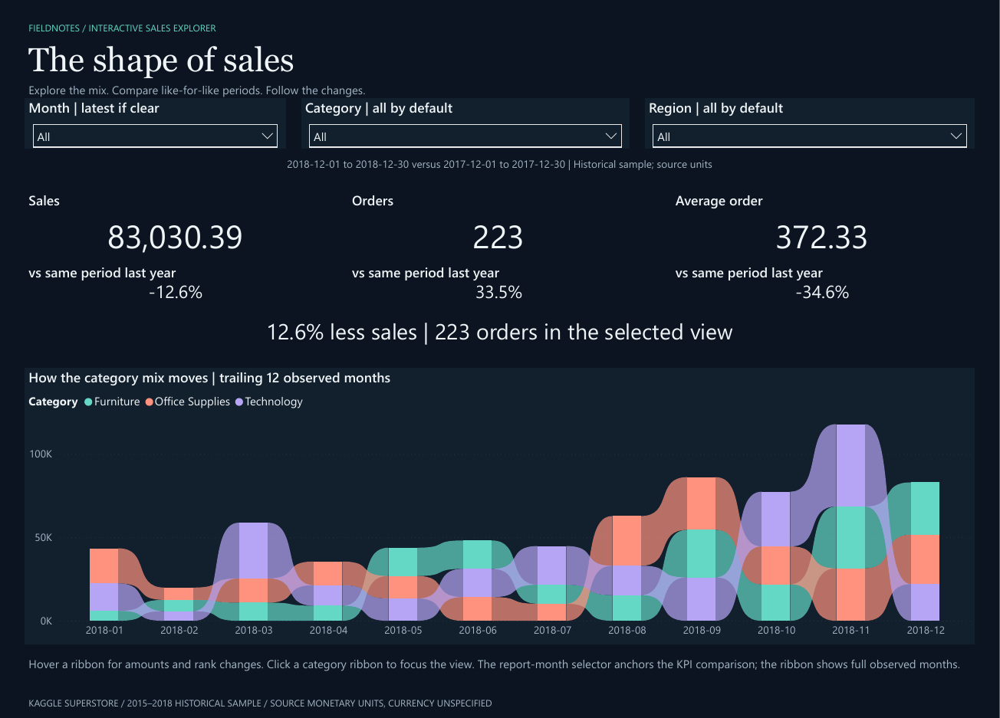

# Monthly Sales Explorer

   

**Why did sales fall while orders increased, and where should the next review focus?**

A repeatable monthly performance review using **Power BI, Python and SQLite**: 9,800 historical sales lines, 4,922 orders and 48 monthly CSV files.



[Preview the four-page report](deliverables/Monthly%20Sales%20Explorer.pdf) · [Download the interactive PBIX](deliverables/Monthly%20Sales%20Explorer.pbix) · [Read the two-page briefing](deliverables/case-study.pdf)

## Findings

For **Dec 1–30, 2018 versus Dec 1–30, 2017**:

- Sales fell **12.6%**, from 95,007.35 to 83,030.39 in source monetary units.
- Orders rose **33.5%**, while average order value fell **34.6%**.
- East (−7,961.58) and Office Supplies (−7,265.53) are the largest regional and category decline leads. These overlapping views must not be added together.

The next investigation is product mix and source coverage within those segments. [Ranked follow-ups](deliverables/review_actions.csv) identify source product IDs to inspect; the data does not establish a cause.

## Explore or reproduce

**Power BI:** Open the PBIX with its imported sample. Use synchronized month, category and region filters, then inspect drivers and product-to-source detail. [Open and refresh guide](powerbi/README.md).

**Python-only review:** From the repository root, with Python 3.10+:

```sh
python refresh.py --summary-only
```

Open the HTML report in the run folder referenced by `runs/latest.json`. SQL extracts, a SQLite database, input hashes and the follow-up CSV accompany the report.

**Supporting Excel output:** [Ready-to-open workbook](deliverables/monthly-sales_2018-12.xlsx) · [Excel preview](deliverables/excel-sales-review.png). Rebuilding Excel requires the optional authoring runtime documented in [setup](docs/SETUP.md).

## How it works

Monthly CSVs → Python validation → SQLite/SQL comparisons → a validated snapshot for Power BI. A separate reporting command creates HTML/CSV outputs and optional Excel/PDF files. Duplicate conflicts stop publication, repeated runs do not accumulate totals, and saved review notes rejoin by business key.

[SQL comparisons](sql/review_drivers.sql) · [Python analysis](src/business_review.py) · [Editable Power BI project](powerbi/SalesExplorer.pbip) · [Model measures](powerbi/native-measures.dax)

## Technical detail

- [Operating, reproduction and validation guide](docs/PROJECT_GUIDE.md)
- [Refresh and review-note handoff](docs/REFRESH_GUIDE.md)
- [Method and comparison definitions](docs/METHOD.md)
- [Native Power BI checks and refresh replay](powerbi/NATIVE_QA.md)
- [Tests](tests) · [Independent verification](docs/independent-verification.json)
- [Source and licensing](docs/SOURCES.md) · [Visual design](docs/DESIGN.md)

## Scope

Independent portfolio demonstration using historical Kaggle Superstore data (2015–2018), replayed as monthly deliveries. Comparisons use a common day-of-month cutoff; this does not establish complete source coverage. Currency is unspecified, and sales are not profit or a forecast. Refresh is a local workflow; cloud scheduling is not configured.

Original code/documentation: [MIT](LICENSE). Data-derived files retain the source's GPL 2 label: [data license](data/LICENSE), [NOTICE](NOTICE).
