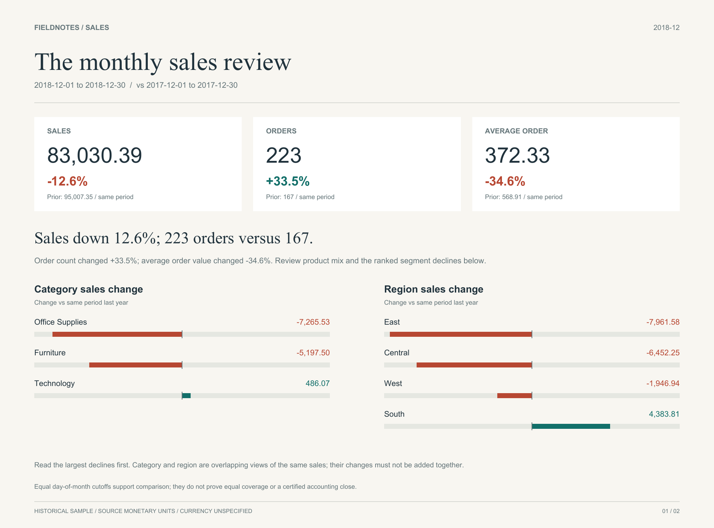

# Monthly Sales Report Automation

**Add sales CSVs. Get a written explanation of what changed and a ranked list of products to investigate.**

A working Python/SQL/Excel portfolio project built from a downloaded Kaggle Superstore sample: **9,800 sales lines, 4,922 distinct orders and 48 historical monthly files**. It returns a useful business review, with source product IDs for follow-up, alongside recurring spreadsheet automation.



## What it returns

For **Dec 1–30, 2018 vs Dec 1–30, 2017**, sales declined **12.6%** (95,007.35 → 83,030.39), although orders increased **33.5%** (167 → 223). Average order value fell **34.6%** (568.91 → 372.33). Values use source monetary units.

The report identifies **East (−7,961.58)** and **Office Supplies (−7,265.53)** as the leading regional/category review leads. The generated CSV ranks five declining segments and lists source product IDs with the largest losses in each. These overlapping views must not be added together. This is a traceable starting point for investigation, not an invented recommendation to cut staff or reorder stock.

- [Open the sales review](deliverables/sales-review.html) — download and open locally; GitHub displays HTML source.
- [Prioritized follow-up CSV](deliverables/review_actions.csv)
- [Actual Excel business-review preview](deliverables/excel-sales-review.png)

**A fresh clone produces these useful outputs using only Python 3.10+:**

```sh
python refresh.py --summary-only
```

Read `runs/latest.json`, then open `sales-review.html` in the referenced run folder. The CSV sits beside it. No package installation, account, Node runtime or spreadsheet dependency is needed for this path. SQL extracts, a SQLite database and input hashes accompany each run.

The report uses the latest recorded day of the latest input month as a common day-of-month cutoff for both years (limited to their common calendar days). Missing prior-year delivery means unavailable; an explicitly empty file means zero. Equal cutoffs do not prove equal source coverage or an accounting close.

## Inspect the deliverables

- [Ready-to-open workbook](deliverables/monthly-sales_2018-12.xlsx)
- [Two-page case study](deliverables/case-study.pdf)
- [Actual refresh replay evidence](docs/refresh-demonstration.json)
- [Independent verification](docs/independent-verification.json)
- [Excel preview](deliverables/excel-monthly-report.png)
- [Refresh guide](docs/REFRESH_GUIDE.md), [setup](docs/SETUP.md), [method](docs/METHOD.md), [source and license](docs/SOURCES.md)

## Optional Excel generation

The 48 selected-column CSV inputs are included, so a fresh download is not required. No customer names or addresses are bundled. With Python 3.10+, Node.js and the documented compatible spreadsheet runtime:

```sh
python refresh.py
```

The Excel path adds a workbook to the same business-review outputs. The program creates a unique folder in `runs/` containing `monthly-sales_YYYY-MM.xlsx`, a SQLite database, SQL extracts, input hashes, processing log and formula-verification evidence. `runs/latest.json` points to the last fully generated workbook. Older successful runs remain available. See [SETUP.md](docs/SETUP.md) for the actual authoring dependency and environment variables; this is a local workflow, not a hosted service.

## What is automated

1. Validate required columns, stable Row IDs, day/month/year dates, filename months and supported amounts.
2. Skip identical repeat IDs; reject conflicts rather than silently choosing a record.
3. Rebuild SQLite and SQL aggregates from the current delivery-folder snapshot. Repeated runs do not accumulate prior totals.
4. Build a four-sheet workbook with live formulas, a native chart, typed period dates and a review-status dropdown.
5. Rejoin saved review notes by **month + category**, regardless of row position.
6. Publish a new version only after workbook generation succeeds. A rejected import keeps the previous successful pointer and workbook.

## Proof that a new month works

| Replay step | Monthly files | Sales lines | Observed sales, source units |
|---|---:|---:|---:|
| Through November 2018 | 47 | 9,341 | 2,178,506.3939 |
| Add December 2018 | 48 | 9,800 | 2,261,536.7827 |
| Run the same input again | 48 | 9,800 | 2,261,536.7827 |

The real spreadsheet engine ran all three refreshes. A temporary demonstration note survived. A conflicting-row test then preserved the last successful version. [Thirteen replay assertions passed](docs/refresh-demonstration.json). The delivered workbook starts with blank review annotations; it contains no invented completed reviews.

## Review notes

Edit the yellow Owner, Review status and Review note cells in **Category review**. Save that sheet as CSV UTF-8, then import it before refreshing:

```sh
python src/import_notes.py exported-review.csv
python refresh.py
```

Saved notes live in the separate, Git-ignored `data/notes/review_notes.csv`. Untouched template rows do not erase notes, and old keys remain stored. Reviewed requires an owner and note. Refresh does not read edits from a prior XLSX automatically. Detailed instructions and a troubleshooting table are in the [refresh guide](docs/REFRESH_GUIDE.md).

## Tests and verification

```sh
python -m unittest discover -s tests -v
pip install -r requirements-qa.txt
python tools/demo_refresh.py
python tools/verify_outputs.py
```

The 32 standard-library tests run without Node or the authoring package; publication tests use a clearly identified writer test double. The separate replay uses actual Excel generation, and independent QA inspects the delivered workbook. Six full-data reconciliations check row partitions and SQL totals. Native desktop Excel recalculation was not tested.

To reproduce the visual briefing and compact bundle:

```sh
pip install -r requirements-visuals.txt
python tools/build_presentation.py
python tools/package_project.py
```

## Relevant remote work

Recurring spreadsheet updates; CSV cleanup and merging; SQL summaries; exception handling; lightweight Python automation; clear refresh documentation. This is a personal portfolio demonstration, not a claimed client engagement or production deployment.

## Data context

Kaggle [Superstore Sales Dataset](https://www.kaggle.com/datasets/rohitsahoo/sales-forecasting), uploader Rohit Sahoo, downloaded October 15, 2026. The data card labels it **GPL 2**. It is a historical sample, not verified transactions from a current retailer. The input CSVs replay one frozen source file as monthly deliveries; Kaggle lists its update frequency as Never. Dates span Jan 3, 2015–Dec 30, 2018. File presence does not prove a complete calendar month's business activity.

Currency is unspecified by the mirror. Sales remain in source monetary units, with four-decimal precision preserved in integer ten-thousandths; Excel displays two decimals. Sales are not profit, cash receipts or a forecast.

Original project code and documentation: MIT, [LICENSE](LICENSE). Included dataset values and data-derived reports retain the Kaggle source's GPL 2 label; see [data/LICENSE](data/LICENSE) and [NOTICE](NOTICE). Original file SHA-256: `dbb0f167b27ccf02d7ff8cb0446a9abc6dbc3522e83cf9daa6939801acfdd196`.
