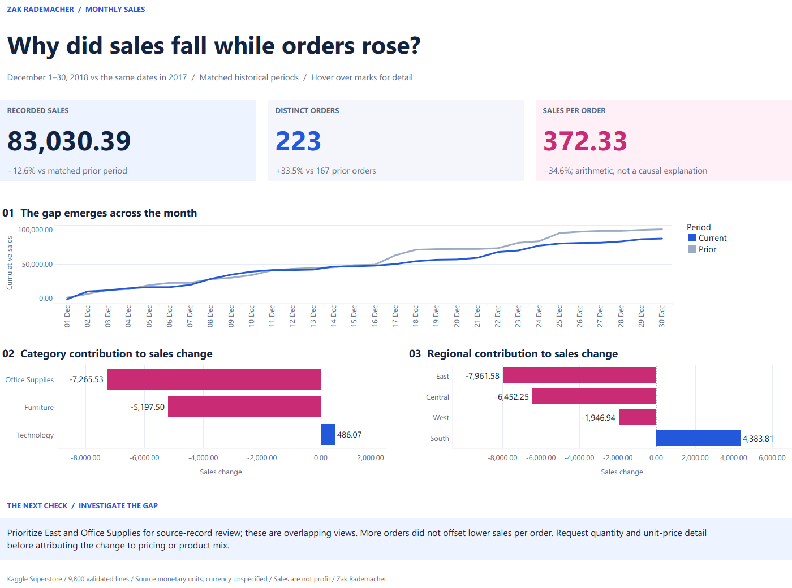

# Monthly Sales Review

**Why did sales fall while orders increased?**

For **December 1–30, 2018 versus the same dates in 2017**, recorded sales fell **12.6%** while distinct orders rose **33.5%**. Sales per order fell **34.6%**. East (−7,961.58 source units) and Office Supplies (−7,265.53) are separate, overlapping investigation leads; their contributions must not be added together or treated as causes.

Python and SQLite validate **9,800 historical lines, 4,922 orders and 48 monthly exports**. Tableau provides a fixed decision brief; Power BI provides the filter-responsive explorer. Currency, quantities, unit prices and profit are not established by this source.

[View current Tableau preview](deliverables/tableau-sales-preview.png) · [Download Tableau workbook](deliverables/Monthly%20Sales%20Review.twbx) · [Power BI explorer](deliverables/Monthly%20Sales%20Explorer.pbix) · [SQL](sql/review_drivers.sql) · [Reproduce](#explore-or-reproduce)



The Tableau package includes reporting data. Its written findings describe the fixed December population; arbitrary worksheet filtering does not rewrite them. The Power BI explorer has its own documented selectors. [Scope and definitions](docs/TABLEAU_REVIEW.md) · [Current Power BI PDF](deliverables/Monthly%20Sales%20Explorer.pdf).

The next check is source coverage and product mix within the listed segments. Request quantity and unit-price data before assigning a price or volume explanation. [Ranked source-product follow-ups](deliverables/review_actions.csv) · [Download the browser companion](deliverables/Monthly%20Sales%20Interactive.html).

[Earlier Tableau layout](https://github.com/ZakJRademacher/monthly-sales-automation/blob/e885e9667301ddeeec8753f4f63c8b5b43a538ab/deliverables/Monthly%20Sales%20Review.twbx) and [earlier two-page briefing](deliverables/case-study.pdf) remain historical references. [Independent November review exercise](docs/INDEPENDENT_PRACTICE.md).

## Explore or reproduce

**Power BI:** Open the PBIX with its imported sample. Use synchronized month, category and region filters, then inspect drivers and product-to-source detail. [Open and refresh guide](powerbi/README.md).

**Python-only review:** From the repository root, with Python 3.10+:

```sh
python refresh.py --summary-only
```

Open the HTML report in the run folder referenced by `runs/latest.json`. SQL extracts, a SQLite database, input hashes and the follow-up CSV accompany the report.

**Supporting Excel output:** [Ready-to-open workbook](deliverables/monthly-sales_2018-12.xlsx) · [Excel preview](deliverables/excel-sales-review.png). Rebuilding Excel requires the optional authoring runtime documented in [setup](docs/SETUP.md).

## How it works

Monthly CSVs → Python validation → SQLite/SQL comparisons → a validated snapshot for Power BI. A separate reporting command creates HTML/CSV outputs and optional Excel/PDF files. Duplicate conflicts stop publication, repeated runs do not accumulate totals, and saved review notes rejoin by business key.

[SQL comparisons](sql/review_drivers.sql) · [Python analysis](src/business_review.py) · [Editable Power BI project](powerbi/SalesExplorer.pbip) · [Model measures](powerbi/native-measures.dax)

## Technical detail

- [Operating, reproduction and validation guide](docs/PROJECT_GUIDE.md)
- [Refresh and review-note handoff](docs/REFRESH_GUIDE.md)
- [Method and comparison definitions](docs/METHOD.md)
- [Native Power BI checks and refresh replay](powerbi/NATIVE_QA.md)
- [Tests](tests) · [Independent verification](docs/independent-verification.json)
- [Source and licensing](docs/SOURCES.md) · [Visual design](docs/DESIGN.md)

## Scope

Independent portfolio demonstration using historical Kaggle Superstore data (2015–2018), replayed as monthly deliveries. Comparisons use a common day-of-month cutoff; this does not establish complete source coverage. Currency is unspecified, and sales are not profit or a forecast. Refresh is a local workflow; cloud scheduling is not configured.

Original code/documentation: [MIT](LICENSE). Data-derived files retain the source's GPL 2 label: [data license](data/LICENSE), [NOTICE](NOTICE).


## Presentation history

[Cover preview](deliverables/portfolio-cover-wide.png) · [Motion cover](deliverables/portfolio-motion.webm) · [Design maintenance](docs/VISUAL_DESIGN.md) · [November 1 release record](docs/DASHBOARD_RELEASE.md). Covers are presentation assets; native report behavior is documented separately.
