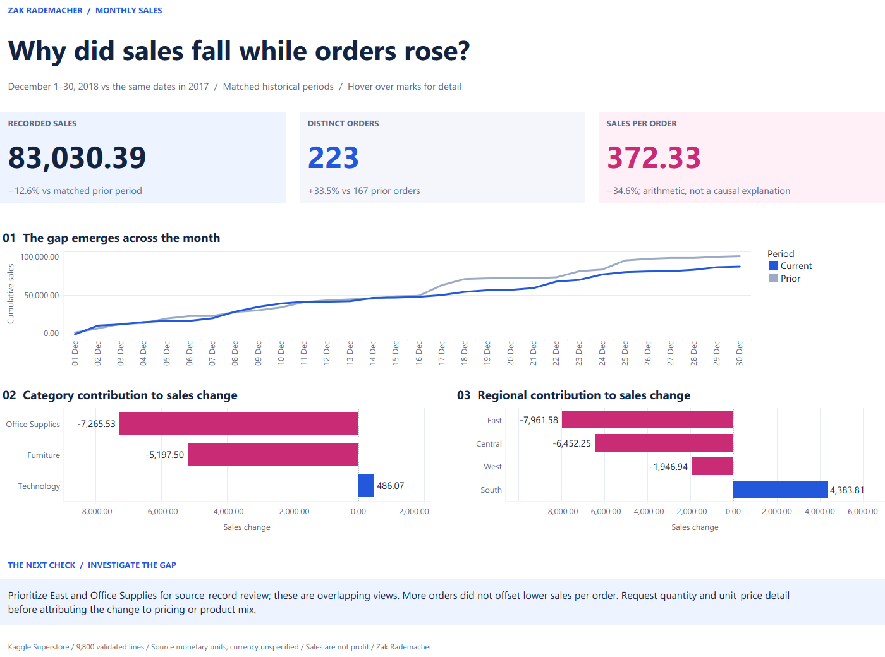

# Monthly Sales Review — Tableau guide

**Question:** Why did sales fall while orders rose?

Matched December 1–30 periods: sales fell 12.6% while orders rose 33.5%. Sales per order fell 34.6%. East and Office Supplies are overlapping investigation leads, not additive contributions or proven causes.

The brief uses validated Python/SQL aggregates for one fixed historical population. The KPI and written interpretation stay fixed when an individual worksheet is filtered. The native workbook was opened and checked in Tableau Desktop on October 29, 2026. [Download the packaged workbook](../deliverables/Monthly%20Sales%20Review.twbx), including its reporting data, or use the [editable source and reproduction guide](../tableau/README.md). There is no Tableau Public deployment.

The repository overview links to the analysis, companion files, and source instructions. Data attribution and licensing still apply to the packaged reporting data.

## November 1, 2026 release recheck

A disposable copy of the current public package opened in Tableau Desktop 2026.3. The fixed December 1–30, 2018 versus 2017 view showed 83,030.39 recorded sales, 223 orders, 372.33 sales per order and the documented −12.6%, +33.5% and −34.6% comparisons. East showed −7,961.58 and Office Supplies −7,265.53. Invoking the source refresh shortcut preserved the view without a visible error. The 42 portable workflow tests pass.

The package's reporting data were unchanged. This is a fixed-brief inspection, not a claim that worksheet filtering rewrites its text, a changed-source refresh test or a new report publication. The workbook and report design are unchanged.
