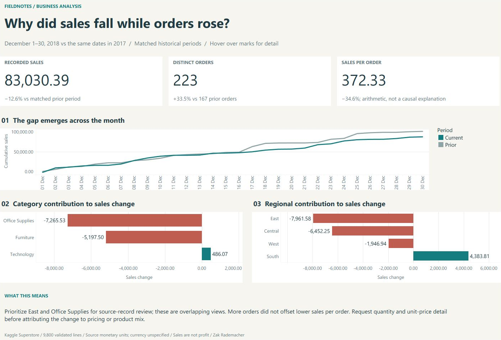

# Monthly Sales Review — Tableau preview

**Question:** Why did sales fall while orders rose?

Matched December 1–30 periods: sales fell 12.6% while orders rose 33.5%. Sales per order fell 34.6%. East and Office Supplies are overlapping investigation leads, not additive contributions or proven causes.

This is a fixed historical decision brief built from validated Python/SQL aggregates. KPI and interpretation text refer to that fixed population; arbitrary worksheet filtering does not recalculate the written findings. The native workbook was opened and checked in Tableau Desktop on October 29, 2026. [Download the packaged workbook](../deliverables/Monthly%20Sales%20Review.twbx), including its reporting data, or use the [editable source and reproduction guide](../tableau/README.md). There is no Tableau Public deployment.

The existing public analysis, source instructions and earlier Excel/Power BI deliverables remain available from the repository README. Existing source attribution and data licenses continue to apply.
